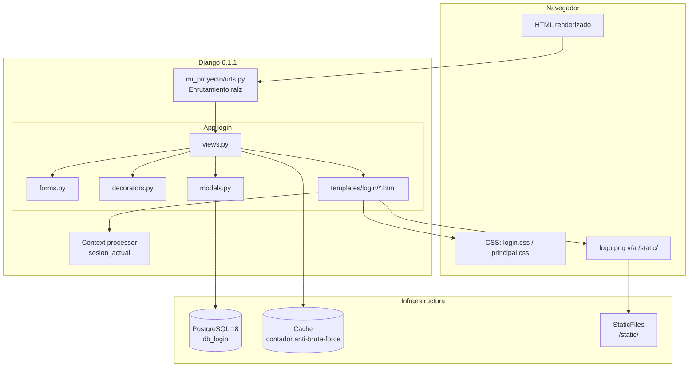
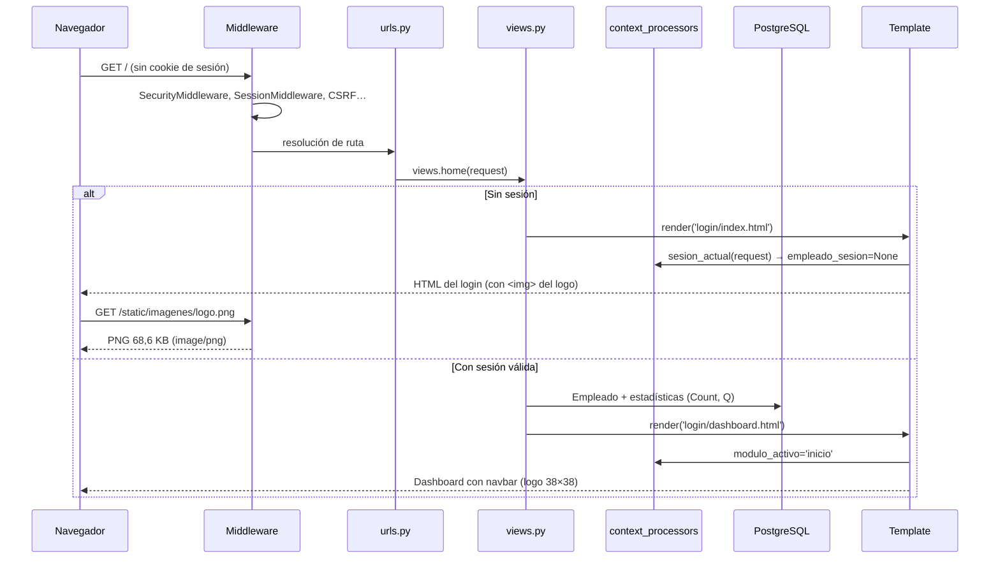

# INFORME TÉCNICO DEL PROYECTO — `proyecto_menu`

**Proyecto:** Aplicación web de gestión de empleados y departamentos con login, roles y auditoría (marca comercial: **VOLTRIX**)
**Tecnología:** Python 3.14.5 + Django 6.1.1 (MVT), PostgreSQL 18, HTML5 + CSS3 puro
**Fecha de esta intervención:** 2026-10-11 (adaptación del logo) · 2026-10-11 (desactivación lógica)
**Alcance de este informe:** Adaptación del logo al diseño + desactivación lógica en los CRUD + documentación didáctica completa del funcionamiento real del código
**Confidencialidad:** Este documento NO reproduce la `SECRET_KEY`, contraseñas de base de datos ni datos personales. Las credenciales de desarrollo permanecen únicamente en `mi_proyecto/settings.py` (sin cambios de valor en esta intervención).

---

## SECCIÓN 1. Resumen del proyecto

### 1.1 ¿Qué hace el proyecto?

Es una **aplicación web interna de empresa** con dos grandes zonas:

1. **Página de login** (`/`): formulario de usuario/contraseña con diseño dividido (panel de marca a la izquierda, formulario a la derecha).
2. **Panel administrativo** (`/` tras autenticarse): dashboard con estadísticas, buscador y directorio de empleados.

Módulos funcionales:

| Módulo | Rutas | Descripción |
|---|---|---|
| Sesión | `/`, `/logout/` | Login con contraseña hasheada, protección anti-fuerza-bruta, rotación de sesión, cierre de sesión |
| Empleados | `/empleados/…` | Listado, detalle, crear, editar, eliminar, asignar rol/estado, restablecer contraseña |
| Departamentos | `/departamentos/…` | Listado, detalle, crear, editar, eliminar (con protección de integridad) |
| Perfil propio | `/perfil/…` | Ver datos, editar identidad, cambiar contraseña |
| Auditoría | `/auditoria/` | Historial de acciones administrativas y de seguridad (solo administradores) |

**Bajas (desde 2026-10-11):** los borrados de Empleados y Departamentos son **desactivaciones lógicas** (`activo=False`): los registros se conservan con su PK, datos y relaciones, desaparecen de los listados operativos, pueden consultarse históricamente (`?estado=inactivos`) y reactivarse cuando corresponda. No hay borrado físico ni en cascada desde la aplicación ni desde el panel `/admin/`.

### 1.2 Tecnologías principales

- **Backend:** Python 3.14.5 + Django 6.1.1 (arquitectura MVT: Model-View-Template)
- **Base de datos:** PostgreSQL 18 (motor `django.db.backends.postgresql`, driver `psycopg` 3.3.6)
- **Frontend:** HTML5 + CSS3 puro (sin framework CSS), iconos FontAwesome 6.4.0 y fuente Inter (CDN)
- **Sesiones:** sesiones de Django en base de datos (1 h de vida, expiran al cerrar el navegador, cookie HttpOnly)

### 1.3 Objetivo de esta intervención

1. **Adaptar el logo** (`login/static/imagenes/logo.png`) al diseño y a la tecnología del proyecto: el archivo original pesaba **446.950 bytes (436,5 KB)** con **1254×1254 px** para mostrarse en un hueco de **38×38 px** (32×32 en móvil). Se redimensionó y optimizó conservando identidad visual, proporciones, colores y transparencia.
2. **Integrar el logo** en el hueco de la página de login, donde el CSS ya lo anticipaba pero se mostraba un icono de FontAwesome como relleno.
3. **Mejorar** los atributos de la etiqueta `` (`alt` descriptivo, `width`/`height` contra desplazamiento de layout).
4. **Sustituir los borrados físicos** de Empleados y Departamentos por **desactivación lógica** (segunda intervención del día): los registros se conservan con su PK, datos y relaciones; se filtran de los listados operativos y pueden consultarse y reactivarse.
5. **Verificar** que nada se rompió (77 pruebas automatizadas + pruebas en vivo).
6. **Documentar** el funcionamiento real del proyecto en orden cronológico de ejecución.

---

## SECCIÓN 2. Arquitectura y estructura de archivos

### 2.1 Estructura de carpetas (relevancia verificada)

```
proyecto_menu/
├── manage.py                     # Punto de entrada CLI de Django (runserver, migrate, test…)
├── requirements.txt              # Dependencias fijadas (Django 6.1.1, psycopg 3.3.6…)
├── INFORME_TECNICO.md            # Informe de la fase anterior (2026-10-08, histórico)
├── LEVANTAMIENTO_TECNICO.md      # Levantamiento de la fase anterior (2026-10-10, histórico)
├── INFORME_TECNICO_PROYECTO.md   # ESTE documento
├── mi_proyecto/                  # Paquete del proyecto Django (configuración)
│   ├── __init__.py
│   ├── settings.py               # Configuración global (BD, apps, middleware, sesiones, estáticos)
│   ├── urls.py                   # Enrutamiento raíz: /admin/ y / → app login; handlers 403/404/500
│   ├── wsgi.py                   # Entry point WSGI (producción)
│   └── asgi.py                   # Entry point ASGI (async/contenedores)
├── login/                        # Aplicación principal (la única app propia)
│   ├── apps.py                   # Config de la app (LoginConfig)
│   ├── models.py                 # Modelos: Departamento, Empleado, RegistroAuditoria
│   ├── views.py                  # Vistas: home, logout, CRUDs, perfil, auditoría, handlers de error
│   ├── forms.py                  # Formularios con validación (ModelForm y Form)
│   ├── urls.py                   # Rutas de todos los módulos
│   ├── decorators.py             # get_empleado_sesion, login_requerido, admin_requerido, puede_gestionar
│   ├── context_processors.py     # sesion_actual: expone empleado_sesion/es_administrador/modulo_activo
│   ├── admin.py                  # Panel /admin/ con hash de contraseña y protecciones
│   ├── tests.py                  # Suite de 66 pruebas
│   ├── migrations/               # 0001_initial, 0002_empleado_password, 0003_…, 0004_departamento_activo_alter_registroauditoria_accion
│   ├── management/commands/      # makeadmin.py, setpassword.py (utilidades de línea de comandos)
│   ├── templates/login/          # Plantillas (base.html + páginas que la extienden)
│   └── static/
│       ├── login/                # principal.css (dashboard) y login.css (página de login)
│       └── imagenes/
│           ├── logo.png                  # ← LOGO OPTIMIZADO (512×512, 68,6 KB)
│           └── logo-original-1254x1254.png  # ← Copia de seguridad del original (436,5 KB)
└── venv/                         # Entorno virtual (Python 3.14.5 + dependencias)
```

### 2.2 Responsabilidad y relaciones de los archivos importantes

| Archivo | Responsabilidad | Se relaciona con |
|---|---|---|
| `manage.py` | Punto de entrada CLI; inyecta `DJANGO_SETTINGS_MODULE=mi_proyecto.settings` | `mi_proyecto/settings.py`, django-core |
| `mi_proyecto/settings.py` | Configuración global: apps instaladas, middleware, BD, sesiones, estáticos, templates y context processors | todos los módulos |
| `mi_proyecto/urls.py` | Enrutamiento raíz; monta `/admin/` e `include('login.urls')`; registra `handler403/404/500` | `login/urls.py`, `login/views.py` |
| `login/urls.py` | Define las 17 rutas de la app con nombre (`name=`) para `` | `login/views.py` |
| `login/views.py` | Lógica de negocio: autenticación, CRUDs con desactivación lógica, reactivación de departamentos, paginación, auditoría, páginas de error | modelos, formularios, decoradores, templates |
| `login/models.py` | Esquema de BD: `Departamento`, `Empleado` (con `password` hasheada y `rol`), `RegistroAuditoria` | migrations, admin, views, forms |
| `login/forms.py` | Validación de formularios (unicidad, contraseñas, limpieza de datos) | models, views |
| `login/decorators.py` | Control de acceso por sesión propia (no usa `django.contrib.auth` para el login) | models, views, context_processors |
| `login/context_processors.py` | Inyecta `empleado_sesion`, `es_administrador`, `modulo_activo` en **todas** las plantillas | decorators, settings, templates |
| `login/templates/login/base.html` | **Layout maestro**: navbar (donde vive el logo), sidebar, área de usuario, pie; define bloques | todas las plantillas hijas, `principal.css` |
| `login/templates/login/index.html` | Página de login (no extiende `base.html`; es autónoma) | `login.css`, logo |
| `login/templates/login/dashboard.html` | Dashboard; extiende `base.html` | `base.html`, views |
| `login/static/login/principal.css` | Estilos del panel (navbar, sidebar, tablas, responsive) | `base.html` y sus hijas |
| `login/static/login/login.css` | Estilos de la página de login | `index.html` |
| `login/static/imagenes/logo.png` | **Asset del logo** servido vía `` | `base.html`, `index.html` |
| `login/admin.py` | Registro de modelos en `/admin/`; hashea contraseña al guardar; protege borrado de departamentos | models |
| `login/tests.py` | 66 pruebas del flujo completo | todos los módulos |
| `login/management/commands/*.py` | Utilidades CLI: `makeadmin` (promueve a admin), `setpassword` (cambia contraseña hasheada) | models |

### 2.3 Diagrama de arquitectura general



---

## SECCIÓN 3. Tecnologías y dependencias

### 3.1 Dependencias fijadas (`requirements.txt`)

| Dependencia | Qué es | Para qué se usa en el proyecto | Dónde aparece |
|---|---|---|---|
| `Django==6.1.1` | Framework web MVT | Motor de la aplicación: enrutamiento, ORM, templates, sesiones, middleware, admin | todo el proyecto |
| `asgiref==3.12.1` | Soporte async para Django | Infraestructura interna de Django (ASGI) | implícito (Django lo requiere) |
| `psycopg==3.3.6` / `psycopg-binary==3.3.6` | Driver PostgreSQL para Python | Conexión del ORM de Django con PostgreSQL | `settings.py` → `DATABASES.ENGINE` |
| `sqlparse==0.6.0` | Parseo de SQL | Dependencia interna de Django (`django.db.backends.utils`) | implícito |
| `tzdata==2026.5` | Base de zonas horarias | `USE_TZ = True` en Windows (sin tzdata del sistema) | `settings.py` |

**Nota:** no se instaló ninguna dependencia nueva en esta intervención. El procesamiento de imagen se hizo con `System.Drawing` de .NET (nativo de Windows), sin tocar el entorno virtual.

### 3.2 Tecnologías del lado del cliente

| Tecnología | Qué es | Dónde aparece | Por qué es adecuada |
|---|---|---|---|
| HTML5 + CSS3 puro | Marcado y estilos sin framework | `templates/login/*.html`, `static/login/*.css` | El proyecto es pequeño y autocontenido; un framework añadiría peso y curva de aprendizaje |
| FontAwesome 6.4.0 (CDN) | Librería de iconos | `index.html` (y antes también en el hueco del logo, ya sustituido) | Iconos vectoriales sin assets locales |
| Google Fonts — Inter (CDN) | Tipografía | `base.html`, `index.html` | Fuente moderna y legible para paneles administrativos |
| PNG con canal alfa | Formato de imagen con transparencia | `static/imagenes/logo.png` | El logo tiene fondo transparente y debe contrastar sobre fondos oscuros |

### 3.3 Componentes internos de Django relevantes

- **`django.contrib.staticfiles`:** descubre y sirve `/static/` en desarrollo (`runserver`). Configurado en `settings.py` con `STATIC_URL = '/static/'` y `STATICFILES_DIRS = [BASE_DIR / 'login' / 'static']` (líneas 133-138).
- **`django.contrib.sessions`:** sesiones en BD (tabla `django_session`).
- **`django.core.cache`:** caché local usado como contador de intentos de login (`views.py`, líneas 45-67).
- **`django.contrib.auth.hashers`:** `make_password`/`check_password` (PBKDF2 por defecto) para el campo `Empleado.password`.

---

## SECCIÓN 4. Flujo cronológico de ejecución

Se distinguen tres órdenes: **importación** (al cargar módulos), **ejecución** (por petición HTTP) e **interacción** (acciones del usuario).

### 4.1 Orden de importación / arranque del proceso

```mermaid
sequenceDiagram
    participante CLI as manage.py
    participante SET as settings.py
    participante URL as mi_proyecto/urls.py
    participant APP as login/apps.py
    CLI->>SET: DJANGO_SETTINGS_MODULE=mi_proyecto.settings
    SET->>SET: BASE_DIR, SECRET_KEY, DEBUG, ALLOWED_HOSTS
    SET->>SET: INSTALLED_APPS (login incluida)
    SET->>SET: MIDDLEWARE, TEMPLATES (context_processors)
    SET->>SET: DATABASES (PostgreSQL), STATIC_*, SESIONES
    CLI->>URL: ROOT_URLCONF = mi_proyecto.urls
    URL->>URL: path('admin/', …), path('', include('login.urls'))
    URL->>URL: handler403/404/500 = login.views.handler*
    APP->>APP: LoginConfig (name='login')
```

1. `manage.py` (línea 9) fija `DJANGO_SETTINGS_MODULE` y llama a `execute_from_command_line`.
2. Django importa `mi_proyecto/settings.py`: define `BASE_DIR`, credenciales, `INSTALLED_APPS` (incluye `'login'`, línea 46), `MIDDLEWARE` (líneas 49-57), `TEMPLATES` con el context processor propio `login.context_processors.sesion_actual` (línea 71), `DATABASES` (PostgreSQL, líneas 87-96), `STATIC_URL`/`STATICFILES_DIRS` (líneas 133-138) y política de sesiones (líneas 149-153).
3. Se carga `mi_proyecto/urls.py`: monta `/admin/` e `include('login.urls')`, y registra los handlers de error personalizados (líneas 13-15).
4. Se carga `login/urls.py` (17 rutas con nombre) y, perezosamente, los módulos de la app.

### 4.2 Orden de ejecución por petición (ciclo request → response)



Paso a paso (petición `GET /`):

1. **Middleware** (`settings.py` líneas 49-57): `SecurityMiddleware` → `SessionMiddleware` → `CommonMiddleware` → `CsrfViewMiddleware` → `AuthenticationMiddleware` → `MessageMiddleware` → `XFrameOptionsMiddleware`.
2. **Enrutamiento:** `mi_proyecto/urls.py` → `login/urls.py` → `path('', views.home, name='home')`.
3. **Vista `home`** (`views.py` líneas 100-184):
   - Si es **POST** (envío del formulario): lee `username`/`password` → calcula clave de intentos (`_clave_intentos`, IP + usuario) → verifica bloqueo (`_esta_bloqueado`, 5 intentos / 300 s) → busca `Empleado` **activo** por correo o nombre (`Q(correo__iexact=…) | Q(nombre__iexact=…)`) → `check_password` contra el hash → si es válido: `request.session.cycle_key()` (anti-fijación), guarda `usuario_id` y `usuario_nombre`, audita (`_auditar`), mensaje de éxito y `redirect('home')`; si falla: registra intento fallido y re-renderiza con error.
   - Si es **GET sin sesión**: renderiza `login/index.html` (la página de login).
   - Si es **GET con sesión**: recarga el empleado (`get_empleado_sesion`), aplica búsqueda (`q`), pagina 10 por página, agrega estadísticas (`Count` con `filter=Q(activo=True)`) y renderiza `login/dashboard.html`.
4. **Context processor** `sesion_actual` (`context_processors.py`): se ejecuta en **cada** renderizado; expone `empleado_sesion`, `es_administrador`, `usuario_sesion_nombre` y `modulo_activo` (resaltado del sidebar según `request.resolver_match.url_name`).
5. **Renderizado:** `dashboard.html` extiende `base.html` (navbar con el logo, sidebar adaptado al rol, área de usuario, formulario de logout con ``) y rellena los bloques `titulo_pagina` y `contenido`.
6. **Estáticos:** el navegador solicita `/static/imagenes/logo.png` y `/static/login/principal.css`; `django.contrib.staticfiles` los sirve desde `login/static/`.

**Filtros de estado (desactivación lógica):** `empleado_list` y `departamento_list` aceptan `?estado=activos` (por defecto), `?estado=inactivos` (consulta histórica) y `?estado=todos` (activos + inactivos). El directorio del dashboard (`home`) muestra solo empleados activos. El selector de departamento en `EmpleadoForm` ofrece solo departamentos activos (al editar un empleado, conserva también el departamento actual aunque esté desactivado, para no forzar reasignaciones involuntarias).

### 4.3 Orden de interacción del usuario

1. El usuario abre `/` → ve el login **con el logo de VOLTRIX** en el hero (42×42 px).
2. Envía credenciales → POST → validación → sesión → redirección al dashboard.
3. Navega por el sidebar (Inicio, Empleados, Departamentos, Mi perfil; los administradores ven además Nuevo empleado y Auditoría).
4. Cada petición pasa por `login_requerido` (o `admin_requerido`); si la sesión expiró, redirige a `/`.
5. Cierra sesión → POST `/logout/` (`@require_POST`) → `session.flush()` → redirección al login.

### 4.4 Operaciones asíncronas / diferidas

No hay tareas en segundo plano (celery ni similares). Lo "diferido" es:
- **Auditoría:** `_auditar` es síncrona pero tolerante a fallos (`try/except` en `views.py` líneas 70-83): nunca rompe la operación principal.
- **Contador de login:** usa la caché con TTL de 300 s (expira solo).
- **Sesiones:** la cookie expira al cerrar el navegador (`SESSION_EXPIRE_AT_BROWSER_CLOSE`) con vida máxima de 1 h.

---

## SECCIÓN 5. Explicación detallada del código

> Se documentan los archivos examinados en esta intervención. Los templates secundarios (`empleado_*.html`, `departamento_*.html`, `perfil_*.html`, `auditoria_list.html`, `403/404/500.html`, `_pagination.html`) siguen el mismo patrón (extienden `base.html` o son páginas autónomas de error) y se listan en el inventario sin análisis línea por línea.

### 5.1 `manage.py` (raíz)

- **Función:** punto de entrada CLI de Django.
- **Importaciones:** `os`, `sys`, `django.core.management.execute_from_command_line`.
- **Lógica:** `os.environ.setdefault('DJANGO_SETTINGS_MODULE', 'mi_proyecto.settings')` (línea 9) y `execute_from_command_line(sys.argv)` (línea 18).
- **Motivo:** convención estándar de Django; permite `runserver`, `migrate`, `test`, `shell`, `findstatic`, y los comandos propios `makeadmin`/`setpassword`.
- **Error potencial:** si el venv no está activado, falla el `import django` (el mensaje de error ya lo explica, líneas 14-17).

### 5.2 `mi_proyecto/settings.py`

- **Función:** configuración global.
- **Variables clave:**
  - `BASE_DIR` (línea 11): raíz del proyecto.
  - `SECRET_KEY` (líneas 20-23): toma `DJANGO_SECRET_KEY` del entorno con *fallback* de desarrollo (no se reproduce aquí).
  - `DEBUG` (línea 27) y `ALLOWED_HOSTS` (líneas 30-34): configurables por entorno.
  - `INSTALLED_APPS` (líneas 39-47): apps de Django + `'login'`.
  - `TEMPLATES` (líneas 61-75): `APP_DIRS: True` (encuentra `login/templates/`) y el context processor propio (línea 71).
  - `DATABASES` (líneas 87-96): PostgreSQL, sobrescribible por variables de entorno.
  - `STATIC_URL` / `STATICFILES_DIRS` (líneas 133-138): `/static/` apunta a `login/static` (por eso `` resuelve a `login/static/imagenes/logo.png`).
  - Sesiones (líneas 149-153): 1 h, HttpOnly, expira al cerrar navegador.
- **Relaciones:** leído por todo el proyecto; `wsgi.py`/`asgi.py` fijan la misma variable de entorno.
- **Limitación:** el *fallback* de `SECRET_KEY` y la contraseña de BD de desarrollo están en el archivo (aceptable en desarrollo; ver sección 9).

### 5.3 `mi_proyecto/urls.py`

- **Función:** enrutamiento raíz.
- **Contenido:** `path('admin/', admin.site.urls)`, `path('', include('login.urls'))`, y los handlers `handler403/404/500` (líneas 13-15) que apuntan a `login.views.handler*` para mostrar páginas de error con la identidad del proyecto.
- **Motivo:** separar el proyecto de la app; los handlers personalizados mejoran la UX ante errores.

### 5.4 `login/urls.py`

- **Función:** 17 rutas con nombre (`name=`) usadas por `` en templates y `reverse()` en vistas/tests.
- **Ejemplo:** `path('empleados/<int:pk>/', views.empleado_detail, name='empleado_detail')`.
- **Motivo del diseño:** URLs semánticas y nombres estables (desacoplan plantillas de la ruta concreta).

### 5.5 `login/models.py`

- **Modelos:**
  - `Departamento`: `nombre` (único), `descripcion`; orden por `nombre`.
  - `Empleado`: nombre, apellido, `correo` (único), puesto, FK `departamento` (`CASCADE`, `related_name='empleados'`), `fecha_ingreso` (`auto_now_add`), `activo`, `rol` (`choices=ROLES`, por defecto `empleado`), `password` (`CharField(max_length=128)`, **siempre hasheada**).
  - Propiedades: `es_administrador`, `nombre_completo`, `iniciales` (avatar en el dashboard).
  - Métodos: `set_password(raw)` → `make_password`; `check_password(raw)` → `check_password` de Django (compara contra el hash PBKDF2).
  - `RegistroAuditoria`: `fecha` (`auto_now_add`), `usuario` (cadena, no FK: sobrevive a borrados), `modulo`, `accion`, `detalle`, `ip`; elección de `MODULOS`/`ACCIONES`.
  - `Departamento.activo` (**nuevo**, migración `0004`): desactivación lógica; `False` = baja reversible. `Empleado` ya disponía de `activo` desde fases anteriores.
  - `RegistroAuditoria.ACCIONES` incluye ahora `desactivar` y `reactivar`; se conserva `eliminar` para que los registros históricos de auditoría (borrados físicos de fases anteriores) sigan mostrando su etiqueta original.
- **Motivo:** el rol por defecto es `empleado` (principio de mínimo privilegio); el `usuario` de auditoría es texto para conservar el historial aunque el empleado se elimine.
- **Error potencial:** `Empleado.password` no es el `User` de Django; por eso la validación de contraseñas que requiere el objeto usuario se omite de forma segura en `setpassword.py` (comentario en líneas 37-39).

### 5.6 `login/views.py` (575 líneas)

- **Constantes:** `LOGIN_MAX_INTENTOS = 5`, `LOGIN_BLOQUEO_SEGUNDOS = 300`, `EMPLEADOS_POR_PAGINA = 10`, `DEPARTAMENTOS_POR_PAGINA = 10`, `AUDITORIA_POR_PAGINA = 15`.
- **Utilidades privadas:**
  - `_ip_cliente`: respeta `X-Forwarded-For` (proxy inverso).
  - `_clave_intentos`: `login_intentos:<ip>:<usuario>` para la caché.
  - `_esta_bloqueado` / `_registrar_intento_fallido` / `_limpiar_intentos`: protección anti-fuerza-bruta tolerante a fallos (si la caché no está disponible, **nunca** bloquea el login).
  - `_auditar`: escribe en `RegistroAuditoria` (nunca almacena contraseñas; `detalle` truncado a 1000 caracteres).
  - `_paginar`: `Paginator` con `page` por GET; ante error vuelve a la página 1.
- **Vistas principales:**
  - `home`: login + dashboard (ver sección 4.2).
  - `logout_view`: `@require_POST` + `@login_requerido`; audita y hace `session.flush()`.
  - CRUD de empleados: `empleado_list/detail/create/update/delete/rol/contrasena`.
  - CRUD de departamentos: `departamento_list/detail/create/update/delete` + `departamento_reactivar` (solo POST).
  - `empleado_delete` y `departamento_delete`: **desactivación lógica** (`activo=False`), nunca borrado físico; conservan PK, datos y relaciones; auditan con acción `desactivar`. Protecciones conservadas: no desactivarse a sí mismo, no desactivar al último administrador activo e idempotencia (si ya está inactivo, aviso informativo y redirección al detalle). La desactivación de departamentos ya no está bloqueada por tener empleados: al no existir borrado en cascada, los empleados asignados se conservan intactos.
  - `departamento_reactivar` (`@require_POST`, `@admin_requerido`): vuelve a poner `activo=True`, audita `reactivar` y redirige al detalle (misma PK y relaciones).
  - `empleado_rol`: reactivación de empleados mediante el formulario de rol y estado; detecta la reactivación leyendo `estaba_activo` **antes** de `is_valid()` (porque `ModelForm` copia los valores sobre la instancia durante la validación, `construct_instance`) y audita `reactivar` en ese caso.
  - `empleado_list` / `departamento_list`: filtro `estado` (`activos` por defecto, `inactivos`, `todos`); el parámetro se valida y cualquier valor desconocido vuelve a `activos`.
  - Perfil: `perfil`, `perfil_editar`, `perfil_contrasena`.
  - `auditoria_list`: filtros por módulo/acción.
  - `handler403/404/500`: páginas de error personalizadas.
- **Protecciones implementadas (motivo de diseño):**
  - No crear empleados sin contraseña válida (`EmpleadoForm` con `requerir_password=True`).
  - No desactivar/eliminar la propia cuenta (evita auto-bloqueo).
  - No quitar el rol al **último administrador activo**.
  - No eliminar departamentos con empleados.
  - `select_related('departamento')` evita consultas N+1 en listados.

### 5.7 `login/forms.py`

- **Formularios:** `DepartamentoForm`, `EmpleadoForm` (creación con contraseña obligatoria; edición con vacío = conservar), `EmpleadoRolForm`, `EmpleadoPerfilForm`, `ContrasenaPropiaForm`, `ContrasenaAdminForm`.
- **Validaciones destacadas:** unicidad insensible a mayúsculas (`__iexact`) con mensaje amigable; longitud mínima de 8 caracteres; validadores nativos de Django (`validate_password`); confirmación de contraseña en `clean()`.
- **Selector de departamento (`EmpleadoForm.__init__`):** solo departamentos activos para nuevas asignaciones; al editar, incluye también el departamento actual aunque esté desactivado (evita reasignaciones involuntarias al editar otros datos).
- **Motivo:** centralizar la validación (una sola fuente de verdad para vistas y admin).

### 5.8 `login/decorators.py`

- `get_empleado_sesion(request)`: lee `session['usuario_id']`, carga el `Empleado` con `select_related('departamento')`; devuelve `None` si no existe o está inactivo (un empleado desactivado pierde la sesión de inmediato).
- `login_requerido`: redirige a `home` si no hay sesión; inyecta `request.empleado_sesion`.
- `admin_requerido`: además exige `es_administrador`; si no, `messages.error` + `raise PermissionDenied()` → invoca `handler403`.
- `puede_gestionar`: regla de negocio reutilizable.
- **Motivo:** replican el patrón de `django.contrib.auth.decorators` adaptado a la autenticación propia por sesión.

### 5.9 `login/context_processors.py`

- `sesion_actual(request)`: expone a **todas** las plantillas `empleado_sesion`, `es_administrador`, `usuario_sesion_nombre` y `modulo_activo`.
- `modulo_activo` se deriva de `request.resolver_match.url_name` (`home`→`inicio`, `empleado_create`→`nuevo_empleado`, prefijos `empleado*`→`empleados`, `departamento*`→`departamentos`, `perfil*`→`perfil`, `auditoria_list`→`auditoria`).
- **Motivo:** el sidebar de `base.html` resalta la sección activa sin repetir lógica en cada vista.

### 5.10 `login/templates/login/base.html` (layout maestro)

- **Estructura:** `<header class="navbar">` con `.logo-area` (donde se muestra el logo), `.brand-info` ("VOLTRIX" + "Panel administrativo"), `.user-area` (nombre del usuario y formulario de logout con CSRF); `.dashboard-layout` con `<aside class="sidebar">` y `<main class="main-container">` (mensajes + ``); `<footer>`.
- **Bloques:** `titulo_pagina`, `estilos_extras`, `contenido`.
- **Logo (estado tras la intervención, líneas 38-43):**
  ```html
  <span class="logo">
    
  </span>
  ```
- **Motivo:** un único layout maestro garantiza identidad visual y navegación consistentes; los hijos solo rellenan bloques.

### 5.11 `login/templates/login/index.html` (página de login)

- Página **autónoma** (no extiende `base.html`): dos paneles (`.hero-section` con branding y `.form-section` con el formulario POST + CSRF).
- **Logo (estado tras la intervención, líneas 30-36):**
  ```html
  <div class="brand-logo">
      
      <div>
          <h2>VOLTRIX</h2>
          <p>Tecnología que impulsa personas</p>
      </div>
  </div>
  ```
- **Motivo del cambio:** el CSS ya contenía reglas `.brand-logo img` listas para la imagen; antes se usaba un icono FontAwesome (`fa-shapes`) como relleno.

### 5.12 `login/static/login/principal.css` y `login.css`

- `principal.css`: variables CSS, navbar oscura (`linear-gradient(180deg, #101B31, #0D1728)`), `.logo-area`, `.logo` (caja 38×38 con degradado azul y borde), `.logo img` (100% + `object-fit: contain`), sidebar, tablas, tarjetas, paginación y **media queries** (≤768 px, ≤450 px: `.logo` pasa a 32×32).
- `login.css`: layout dividido del login, `.brand-logo` (hueco 42×42 con borde de acento), `.brand-logo img` (`object-fit: contain`), formularios, responsive.
- **Motivo de `object-fit: contain`:** el logo es vertical (618×1038 de contenido) y el hueco es cuadrado; `contain` lo escala sin deformar ni recortar.

### 5.13 `login/admin.py`

- `EmpleadoAdminForm.clean_password`: vacío = conservar; si ya tiene formato de hash (`pbkdf2_`, `argon2`, `scrypt`, `bcrypt`) lo guarda tal cual; si no, hashea.
- `DepartamentoAdmin`: `has_delete_permission` y `delete_model` impiden borrar departamentos con empleados.
- `EmpleadoAdmin`: lista, filtros y búsqueda.
- **Sin borrado físico en `/admin/`:** ambos `ModelAdmin` definen `has_delete_permission() → False`, por lo que el panel ya no ofrece el borrado de Empleados ni Departamentos; las bajas se gestionan desde la app (desactivación lógica). `DepartamentoAdmin` ya no necesita la antigua protección de borrado con empleados (no hay cascada que evitar).

### 5.14 `login/management/commands/makeadmin.py` y `setpassword.py`

- `makeadmin <correo>`: asigna `rol='admin'` a un empleado existente (bootstrap de roles).
- `setpassword <correo> [--password]`: cambia la contraseña (mínimo 8 caracteres + validadores nativos) y la almacena hasheada.
- **Motivo:** utilidades de línea de comandos para administración inicial sin exponer el panel.

### 5.15 Plantillas de los CRUD (desactivación lógica)

- `empleado_confirm_delete.html` / `departamento_confirm_delete.html`: título y textos cambiados de «Eliminar» a «Desactivar»; la nota explica que los datos se conservan y cómo reactivar.
- `empleado_list.html` / `departamento_list.html`: chips de filtro de estado (Activos / Inactivos / Todos, clases `.filtro-estado` y `.chip` nuevas en `principal.css`); las filas inactivas muestran un control de reactivación (empleados: enlace a «Rol y estado»; departamentos: formulario POST a `departamento_reactivar`).
- `empleado_detail.html`: si el empleado está activo muestra «🗑️ Desactivar»; si está inactivo, «✅ Reactivar» (enlace a `empleado_rol`).
- `departamento_detail.html`: lógica idéntica con `departamento_delete` / `departamento_reactivar`, más una insignia «Desactivado — los datos se conservan» en la cabecera.

### 5.16 `login/migrations/`

- `0001_initial`: crea `Departamento`, `Empleado` y `RegistroAuditoria`.
- `0002_empleado_password`: añade el campo `password` a `Empleado`.
- `0003_registroauditoria_alter_departamento_options_and_more`: ajustes de opciones/índices.
- `0004_departamento_activo_alter_registroauditoria_accion` (**nuevo**): añade `Departamento.activo` (por defecto `True`, no destructiva: las filas existentes quedan activas) y actualiza las opciones de `RegistroAuditoria.accion` (cambio a nivel de aplicación, sin impacto en los datos).
- **Verificación:** las cuatro migraciones se aplicaron correctamente en la base de pruebas (`manage.py test`).

**Aplicación en producción:** desplegar el código y ejecutar `python manage.py migrate` antes de usar la nueva funcionalidad. La migración solo añade una columna con valor por defecto; no modifica ni elimina datos existentes.

### 5.17 `login/tests.py`

- 77 pruebas (`LoginTests`, `AccesoPorURLTests`, `CRUDEmpleadoTests`, `CRUDDepartamentoTests`, `PerfilTests`, `AuditoriaTests`, `SeguridadTests`, `MigracionesTests` y **`DesactivacionLogicaTests`**, esta última añadida en la segunda intervención) que cubren: formulario visible, login correcto por correo/nombre, contraseña incorrecta, usuario inexistente, empleado inactivo, sin contraseña, dashboard con sesión, el resto de módulos y la desactivación/reactivación lógica.
- `DesactivacionLogicaTests` verifica: conservación de datos y relaciones tras la baja, filtrado de listados (`activos`/`inactivos`/`todos`), acceso al detalle de inactivos, reactivación con la misma PK, permisos de reactivación, selector de departamentos activos, ausencia de borrado físico en `/admin/` y auditoría de `desactivar`/`reactivar`.
- Usan `setUpTestData` (datos compartidos) y `cache.clear()` en `setUp` para aislar el contador de intentos.

---

## SECCIÓN 6. Documentación específica del logo

### 6.1 Ubicación y características verificadas

| Aspecto | Original (antes) | Optimizado (después) |
|---|---|---|
| Ruta | `login/static/imagenes/logo.png` | misma ruta (idéntica) |
| Respaldo del original | — | `login/static/imagenes/logo-original-1254x1254.png` |
| Formato | PNG (firma `89504E47 0D0A1A0A`) | PNG (misma firma) |
| Dimensiones | 1254 × 1254 px | 512 × 512 px |
| Color | RGBA (color type 6, 8 bits/canal) | RGBA (color type 6) |
| Peso | 446.950 bytes (436,5 KB) | 70.257 bytes (68,6 KB) → **84,3 % menos** |
| Transparencia | 87,9 % de píxeles totalmente transparentes | 88,2 % (se conserva el canal alfa) |
| Contenido visible | 618 × 1038 px, centrado (x=308..925, y=125..1162) | mismo lienzo cuadrado, misma composición |

### 6.2 Componentes donde se utiliza

1. **Navbar del panel** (`base.html`, línea 42): hueco `.logo` de **38×38 px** (**32×32 px** en pantallas ≤450 px, `principal.css` líneas 980-983).
2. **Hero de la página de login** (`index.html`, línea 31): hueco `.brand-logo` de **42×42 px** (`login.css` líneas 140-145).

### 6.3 Forma de carga

- Las plantillas usan ``; `django.contrib.staticfiles` resuelve la URL a `/static/imagenes/logo.png` y en desarrollo la sirve desde `login/static/imagenes/` (verificado con `manage.py findstatic` y con una petición HTTP real: `200 image/png`, 70.257 bytes).
- La imagen se carga de forma **eager** (sin `loading="lazy"`) porque está above-the-fold en ambas páginas.

### 6.4 Estilos aplicados y comportamiento responsive

```css
/* principal.css (dashboard) */
.logo img { display: block; width: 100%; height: 100%; object-fit: contain; border-radius: 10px; }
/* login.css (login) */
.brand-logo img { display: block; width: 42px; height: 42px; object-fit: contain; border-radius: 12px; }
```

- `object-fit: contain`: escala la imagen manteniendo la relación de aspecto (el logo es vertical: 618×1038 ≈ 0,595) dentro del hueco cuadrado → **no se deforma ni se recorta**; en 38 px de alto se renderiza ≈ 22,6 × 38 px.
- `display: block` (añadido): elimina el hueco de línea base propio de imágenes `inline`.
- `border-radius`: redondea la caja contenedora; al ser el fondo transparente, solo afecta a los píxeles opacos.
- Responsive: a 450 px el hueco pasa a 32×32 y el logo se reescala automáticamente (mismo archivo, sin duplicar assets).

### 6.5 Cambios realizados (antes/después)

**`base.html` (antes):**
```html
<!-- Espacio reservado para el logo de VOLTRIX (el contenedor .logo está preparado en CSS para recibir una imagen) -->
<span class="logo">
  
</span>
```
**`base.html` (después):**
```html
<!-- Logo de VOLTRIX (imagen optimizada en login/static/imagenes/logo.png) -->
<span class="logo">
  
</span>
```

**`index.html` (antes):** `<i class="fa-solid fa-shapes"></i>` dentro de `.brand-logo` (icono de relleno).
**`index.html` (después):** ``.

### 6.6 Justificación técnica

- **¿Por redimensionar?** El navegador descargaba 436,5 KB para pintar un hueco de 38-42 px. Con 512×512 (12× el hueco mayor) hay margen de sobra para pantallas retina (2×-3×) y la descarga baja a 68,6 KB: **mejora de tiempo de carga, sobre todo en móvil** (donde además el hueco es de 32 px).
- **¿Por PNG y no WebP/JPG?** El logo tiene transparencia (RGBA). JPG no admite alfa; WebP sería válido pero requiere conversión que puede deteriorar bordes y no aporta beneficio significativo a este tamaño; PNG es el formato nativo del activo original y el estándar para logos con transparencia. **Se mantiene PNG.**
- **¿Por no recortar el margen transparente?** El 87,9 % de transparencia es parte de la composición original del artista (margen de seguridad). Recortar cambiaría el equilibrio visual y el tamaño aparente; se optó por conservar el lienzo íntegro (ver recomendación opcional en sección 9).
- **¿Por no tocar colores/elementos?** La instrucción prohíbe alterar la identidad visual; solo se cambió la resolución (remuestreo bícubico de alta calidad), nunca el contenido.

### 6.7 Alternativas consideradas

| Alternativa | Descartada porque |
|---|---|
| Mantener el PNG de 1254 px | 436,5 KB para un hueco de 38 px: rendimiento inaceptable en móvil |
| Convertir a WebP | Conversión innecesaria (riesgo de deterioro); PNG ya es óptimo para logos con alfa a este tamaño |
| Convertir a SVG | El original es raster (PNG), no vectorial; vectorizarlo sería "inventar" una versión nueva del logo |
| Recortar márgenes transparentes | Alteraría la composición visual original (optativo, ver sección 9) |
| Pillow (Python) para el redimensionado | No estaba instalado; `System.Drawing` (nativo de Windows) logró el mismo resultado sin añadir dependencias al proyecto |

### 6.8 Pruebas efectuadas sobre el logo

- Cabecera PNG del nuevo archivo: firma válida, 512×512, color type 6 (RGBA).
- Transparencia conservada: 88,2 % de píxeles transparentes (vs 87,9 % original; la mínima diferencia es el remuestreo).
- `manage.py findstatic imagenes/logo.png`: resuelve la ruta.
- Servidor de desarrollo: `GET /static/imagenes/logo.png` → `200`, `Content-Type: image/png`, 70.257 bytes.
- Renderizado: la etiqueta `` aparece en el HTML servido con los nuevos atributos (login) y en el dashboard autenticado (prueba temporal, sección 8).

---

## SECCIÓN 7. Registro cronológico de modificaciones (esta intervención)

> Secuencia de **esta** intervención (2026-10-11). La historia original del proyecto (fases anteriores, 2026-10-08 y 2026-10-10) está documentada en `INFORME_TECNICO.md` y `LEVANTAMIENTO_TECNICO.md`; no se modificó ningún archivo de esas fases salvo los listados abajo.

| # | Archivo | Estado anterior | Modificación | Motivo | Resultado esperado | Resultado observado | Prueba |
|---|---|---|---|---|---|---|---|
| 1 | `login/static/imagenes/logo-original-1254x1254.png` | no existía | Copia de seguridad del original (446.950 bytes) | No destruir el activo original (operación no destructiva) | Original preservado | Archivo creado con el mismo tamaño | `Get-Item` (446.950 bytes) |
| 2 | `login/static/imagenes/logo.png` | 1254×1254 px, 446.950 bytes, RGBA | Redimensionado a 512×512 px, 70.257 bytes, RGBA, mismo lienzo y composición | Reducir peso (84,3 %) manteniendo identidad, proporciones y transparencia | Logo idéntico visualmente, mucho más ligero | 512×512, 68,6 KB, 88,2 % transparencia | Cabecera PNG + análisis de canal alfa |
| 3 | `login/templates/login/base.html` (líneas 40-43) | `alt="Logo"`, sin `width`/`height`, comentario de "espacio reservado" | `alt="Logo de VOLTRIX"`, `width="38" height="38"`, comentario actualizado | Accesibilidad (alt descriptivo) y evitar desplazamiento de layout (CLS) | Etiqueta semántica y estable | HTML servido muestra los nuevos atributos | `manage.py check` + prueba temporal de navbar |
| 4 | `login/templates/login/index.html` (líneas 30-36) | Icono FontAwesome `<i class="fa-solid fa-shapes">` como relleno | Sustituido por `` del logo (42×42) | El CSS ya anticipaba `.brand-logo img`; integrar el logo real en la marca | Logo visible en el hero del login | Etiqueta `` presente en el HTML servido | Petición HTTP `GET /` (200) |
| 5 | `login/static/login/principal.css` (líneas 147-153) | `.logo img` sin `display` | Añadido `display: block` | Eliminar el hueco de línea base de imágenes inline | Caja de 38 px exacta | Regla presente en CSS servido (200) | `GET /static/login/principal.css` |
| 6 | `login/static/login/login.css` (líneas 139-145) | `.brand-logo img` sin `display`, comentario "Cuando se incorpore…" | Añadido `display: block`, comentario actualizado | Idéntico al anterior | Caja de 42 px exacta | Regla presente en CSS servido (200) | `GET /static/login/login.css` |

**Archivos NO modificados (intervención del logo):** `settings.py`, `urls.py`, `views.py`, `models.py`, `forms.py`, `decorators.py`, `context_processors.py`, `admin.py`, `tests.py`, `requirements.txt`, el resto de plantillas y CSS. No se tocaron `.env` (no existe en el proyecto) ni credenciales.

---

### Segunda intervención (2026-10-11): desactivación lógica

> Secuencia de la segunda intervención del mismo día, posterior a la del logo. Afecta al comportamiento de los CRUD de Empleados y Departamentos.

| # | Archivo | Estado anterior | Modificación | Motivo | Resultado observado | Prueba |
|---|---|---|---|---|---|---|
| 1 | `login/models.py` | `Departamento` sin campo de estado | Añadido `activo = BooleanField(default=True)`; `ACCIONES` ampliadas con `desactivar`/`reactivar` (se conserva `eliminar` para historial) | Reutilizar el mecanismo de estado que ya existe en `Empleado` | Campo y opciones activos | `manage.py test` |
| 2 | `login/migrations/0004_departamento_activo_alter_registroauditoria_accion.py` | no existía | Generada con `makemigrations login` | Registrar el nuevo campo (no destructiva: las filas existentes quedan activas) | Aplicada OK en base de pruebas | `manage.py test` |
| 3 | `login/views.py` — `empleado_delete` | Borrado físico (`empleado.delete()`) | `activo=False` + auditoría `desactivar`; protecciones conservadas (no auto-desactivarse, último administrador, idempotencia) | Sustituir borrado físico por baja reversible | 302; el empleado existe con `activo=False` | `test_desactivar_empleado`, `DesactivacionLogicaTests` |
| 4 | `login/views.py` — `departamento_delete` | Borrado físico bloqueado si tenía empleados | `activo=False` + auditoría `desactivar`; sin bloqueo por empleados (no hay cascada) | Conservar registros y empleados asignados | 302; departamento inactivo, empleados intactos | `test_desactivar_departamento_*` |
| 5 | `login/views.py` — `departamento_reactivar` (nueva) | no existía | Vista `@require_POST` + `@admin_requerido`: `activo=True`, auditoría `reactivar`, redirige al detalle | Reactivación de departamentos | 302; `activo=True` con la misma PK | `test_reactivar_departamento_*` |
| 6 | `login/views.py` — `empleado_list` / `departamento_list` | Sin filtro de estado | `?estado=activos` (defecto) / `inactivos` / `todos`, con validación del parámetro | Ocultar inactivos en listados operativos sin perder consulta histórica | Chips funcionan; inactivos solo en `inactivos`/`todos` | `test_listado_oculta_inactivos_y_permite_consultarlos` |
| 7 | `login/views.py` — `home` | Directorio con todos | `.filter(activo=True)` | Directorio operativo solo activos | Inactivos fuera del dashboard | Suite de login/dashboard |
| 8 | `login/views.py` — `empleado_rol` | Siempre audita `estado` | Detecta reactivación y audita `reactivar` (lee `estaba_activo` antes de `is_valid()`) | Trazabilidad de reactivaciones | Acción `reactivar` registrada | `test_auditoria_registra_desactivacion_y_reactivacion` |
| 9 | `login/forms.py` — `EmpleadoForm` | Todos los departamentos | Selector solo activos (más el actual al editar) | Evitar nuevas asignaciones a inactivos | Queryset filtrado | `test_formulario_empleado_solo_ofrece_departamentos_activos` |
| 10 | `login/urls.py` | 17 rutas | Añadida `departamentos/<int:pk>/reactivar/` | Exponer la reactivación | GET → 405 (solo POST); sin sesión → 302; empleado → 403 | `test_reactivar_departamento_*`, prueba en vivo |
| 11 | `login/admin.py` | Borrado físico disponible | `has_delete_permission() → False` en ambos modelos | Eliminar rutas de borrado físico | Sin borrado en `/admin/` | `test_admin_sin_permiso_de_borrado_fisico` |
| 12 | 6 plantillas de CRUD | Textos y botones de «Eliminar» | «Desactivar», chips de filtro, controles de reactivación | Interfaz coherente con la lógica | Renderizado verificado | Suite (77 OK) |
| 13 | `login/static/login/principal.css` | Sin estilos de filtro | Añadidos `.filtro-estado`, `.chip`, `.inline-form` | Estilo del nuevo filtro | CSS servido (200) | `GET /static/login/principal.css` |
| 14 | `login/tests.py` | 66 pruebas | 4 pruebas de borrado físico reescritas + `DesactivacionLogicaTests` (11 pruebas) | Verificar la nueva semántica | 77 pruebas, todas OK | `manage.py test` |

---

## SECCIÓN 8. Pruebas y resultados

| Prueba | Método | Resultado | Estado |
|---|---|---|---|
| Comprobación del sistema Django | `python manage.py check` | "System check identified no issues (0 silenced)" | Correcto |
| Resolución de la ruta estática del logo | `python manage.py findstatic imagenes/logo.png` | Resuelve a `login/static/imagenes/logo.png` | Correcto |
| Suite de pruebas automatizada | `python manage.py test` | "Ran 77 tests — OK" (incluye 11 pruebas nuevas de desactivación lógica) | Correcto |
| Desactivación lógica (empleado) | Pruebas `DesactivacionLogicaTests` | Registro conservado (`activo=False`), PK, datos y relaciones intactas | Correcto |
| Desactivación lógica (departamento) | Ídem | Sin borrado en cascada; empleados asignados conservados | Correcto |
| Listados con filtro de estado | `?estado=activos/inactivos/todos` | Activos ocultan inactivos; consulta histórica funciona | Correcto |
| Reactivación | `empleado_rol` y `departamento_reactivar` | `activo=True` con la misma PK; auditoría `reactivar` | Correcto |
| Sin borrado físico en `/admin/` | `has_delete_permission` | `False` para Empleado y Departamento | Correcto |
| Ruta de reactivación en vivo | Servidor de desarrollo (`runserver`) | `GET /departamentos/1/reactivar/` → 405 (solo POST); listados con filtros → 302 sin sesión | Correcto |
| Migraciones | Aplicación en base de pruebas (`test_db_login`) | 0001, 0002, 0003 aplicadas "OK" | Correcto |
| Página de login en vivo | Servidor de desarrollo + `GET /` | HTTP 200, 4179 bytes, con `` | Correcto |
| Servicio del logo | `GET /static/imagenes/logo.png` | HTTP 200, `image/png`, 70.257 bytes | Correcto |
| CSS en vivo | `GET /static/login/login.css` y `principal.css` | HTTP 200, reglas `.brand-logo img` / `.logo img` presentes | Correcto |
| Logo en navbar autenticada | Prueba temporal con `Client()` (login → dashboard), eliminada tras usarla | `test_navbar_logo_en_dashboard … ok` (contiene `imagenes/logo.png`, `alt="Logo de VOLTRIX"`, `width="38" height="38"`) | Correcto |
| Integridad de la imagen | Lectura de cabecera PNG + conteo de canal alfa | 512×512, RGBA, 88,2 % transparentes (original 87,9 %) | Correcto |
| Renderizado visual en navegador real (distintas pantallas) | No disponible: no hay herramienta de navegador en este entorno | — | No verificable |
| Contraste del logo sobre el fondo oscuro | No disponible: este modelo no admite entrada de imágenes | — | No verificable |

**Nota sobre el código de salida:** al ejecutar `manage.py test` con redirección `2>&1` en PowerShell, el proceso reporta "Exited with code 1" por el mensaje informativo "Creating test database…" (va a stderr). El resultado real de Django es **"Ran 66 tests … OK"** (un fallo imprimiría "FAILED").

---

## SECCIÓN 9. Problemas pendientes y mejoras recomendadas

### 9.1 Errores / aspectos pendientes (no bloqueantes)

- **Verificación visual no realizada:** no se pudo confirmar el aspecto final en un navegador real ni el contraste del logo sobre el degradado oscuro (`#101B31`). Estructuralmente está verificado (HTTP 200, HTML/CSS correctos, pruebas), pero se recomienda una revisión visual manual en móvil, tableta y escritorio.
- **`SECRET_KEY` y contraseña de BD con fallback en `settings.py`:** funciona en desarrollo; en producción deben definirse solo por variables de entorno (el propio archivo ya lo comenta).
- **Nombres de departamento quedan reservados:** la unicidad de `Departamento.nombre` impide crear un departamento con el mismo nombre que uno desactivado (consecuencia de conservar el registro; es una decisión de integridad de datos, no un error).
- **Purga física de registros antiguos:** no implementada a propósito. Si se necesitara, debe ser una operación explícita de administrador (p. ej. un comando de gestión), nunca parte del CRUD normal.

### 9.2 Mejoras opcionales recomendadas (priorizadas)

1. **Alta prioridad — rendimiento de fuente/iconos:** `index.html` y `base.html` cargan FontAwesome y Google Fonts desde CDN. Sin internet, la página pierde iconos y tipografía. Alternativa: self-hosting o `font-display: swap` ya está implícito en `display=swap`.
2. **Media prioridad — recorte de márgenes del logo (opcional):** el 87,9 % del PNG es transparencia. Recortar al contenido (618×1038) más un margen haría el logo visiblemente más grande en sus huecos de 38-42 px. Requiere autorización porque altera la composición original.
3. **Media prioridad — caché de estáticos en producción:** configurar `STORAGES`/`ManifestStaticFilesStorage` y un CDN; hoy `runserver` sirve estáticos sin caché agresiva.
4. **Baja prioridad — `loading="lazy"` para futuras imágenes** below-the-fold (no aplica al logo, que es above-the-fold).
5. **Baja prioridad — favicon:** no existe `favicon.ico`; el logo optimizado (512×512) es candidato natural para generarlo.
6. **Baja prioridad — `width`/`height` en el resto de `` futuros** para evitar CLS, siguiendo el patrón aplicado al logo.

---

## SECCIÓN 10. Guía de mantenimiento: cómo sustituir el logo en el futuro

1. **Sustituir el archivo:** reemplaza `login/static/imagenes/logo.png` por la nueva imagen (mismo nombre, para que `` siga funcionando sin tocar plantillas).
2. **Proporciones:** el hueco es cuadrado (38×38 y 42×42 px). El logo actual es vertical (contenido 618×1038) y se muestra con `object-fit: contain`, por lo que **no hace falta que sea cuadrado**: cualquier relación de aspecto se escala sin deformarse. Si quieres que se vea más grande, reduce el margen transparente alrededor del dibujo.
3. **Resolución recomendada:** entre 256 px y 512 px de lado (6-12× el hueco mayor) y peso inferior a ~100 KB; conserva el canal alfa (transparencia) si el fondo debe verse a través del logo.
4. **Formato:** PNG para transparencia; no uses JPG (no admite alfa).
5. **Responsive:** no se requiere duplicar assets; el CSS reescala el mismo archivo a 32 px en móvil (media query de `principal.css`).
6. **Revisar después de sustituir:**
   - `python manage.py check`
   - `python manage.py findstatic imagenes/logo.png`
   - `python manage.py test`
   - Recarga la página y comprueba el hueco del navbar y el hero del login.
7. **Bajas y reactivaciones (desactivación lógica):**
   - **Dar de baja:** «🗑️ Desactivar» en el detalle o listado (Empleados y Departamentos). El registro se conserva.
   - **Consultar bajas:** `?estado=inactivos` en los listados; `?estado=todos` para ver todo.
   - **Reactivar:** Empleados inactivos → «✅ Reactivar» (lleva a «Rol y estado»); Departamentos inactivos → «✅ Reactivar» (POST a `/departamentos/<pk>/reactivar/`, solo administradores).
   - **No usar `/admin/` para borrar:** el borrado físico está deshabilitado (`has_delete_permission → False`).
   - **Aplicar la migración en producción:** `python manage.py migrate` antes de desplegar (añade la columna `login_departamento.activo` con valor por defecto `True`; no es destructiva).
8. **Para usar el logo en otros sitios** (favicon, correos): parte de `logo.png` (512×512) o del respaldo `logo-original-1254x1254.png` si necesitas máxima resolución.

---

## SECCIÓN 11. Glosario para aprender programación

| Término | Definición | Ejemplo en el proyecto |
|---|---|---|
| **MVT** | Model-View-Template: patrón de Django. El *Modelo* define datos, la *Vista* la lógica, la *Plantilla* el HTML. | `models.py`, `views.py`, `templates/login/` |
| **ORM** | Object-Relational Mapping: acceder a la BD con objetos Python en lugar de SQL. | `Empleado.objects.filter(activo=True)` |
| **QuerySet** | Conjunto de resultados de una consulta ORM, evaluado perezosamente. | `Empleado.objects.select_related('departamento').order_by('-id')` |
| **`select_related`** | Optimización que une FK en la misma consulta SQL (evita N+1). | `views.py` líneas 156, 206 |
| **Migración** | Archivo que registra cambios del modelo en la BD. | `login/migrations/0002_empleado_password.py` |
| **Context processor** | Función que inyecta variables en todas las plantillas. | `login/context_processors.py` → `sesion_actual` |
| **Decorator** | Función que envuelve a otra para añadir comportamiento. | `@login_requerido`, `@admin_requerido` |
| **CSRF** | Protección contra falsificación de peticiones; token oculto en formularios POST. | `` en `index.html` y `base.html` |
| **Hash de contraseña** | Función irreversible que almacena la contraseña de forma segura (PBKDF2 en Django). | `make_password` / `check_password` en `models.py` |
| **Sesión** | Estado del servidor asociado a una cookie; aquí guarda `usuario_id`. | `request.session['usuario_id']` |
| **Desactivación lógica** | "Borrado" reversible: se marca `activo=False` en lugar de eliminar la fila; conserva PK, datos y relaciones. | `empleado_delete` y `departamento_delete` en `views.py` |
| **``** | Etiqueta de plantilla que genera la URL de un archivo estático. | `` |
| **`object-fit: contain`** | Regla CSS que escala una imagen manteniendo proporciones dentro de su caja. | `.logo img` en `principal.css` |
| **RGBA** | Modelo de color RGB + canal alfa (transparencia). | `logo.png` es RGBA (color type 6) |
| **CLS** | Cumulative Layout Shift: desplazamiento de contenido al cargar; se mitiga con `width`/`height` en ``. | atributos añadidos al logo |
| **Retina / DPR** | Pantallas con 2-3 píxeles físicos por px CSS; exigen imágenes con resolución extra. | 512 px para un hueco de 38-42 px |
| **CDN** | Red de distribución de contenido externa. | FontAwesome y Google Fonts en `index.html` |
| **WSGI / ASGI** | Interfaces estándar entre el servidor web y la aplicación Python. | `mi_proyecto/wsgi.py`, `mi_proyecto/asgi.py` |

---

## SECCIÓN 12. Conclusión

**Cómo funciona la aplicación:** un navegador pide `/`; Django carga `settings.py`, enruta a `views.home` y, sin sesión, renderiza `login/index.html` (login con el logo de VOLTRIX en el hero). Al enviar credenciales, la vista valida contra el hash PBKDF2 del `Empleado`, protege contra fuerza bruta con caché, rota la sesión y lleva al dashboard (`dashboard.html` que extiende `base.html`: navbar con el logo de 38×38, sidebar con resaltado por rol y módulo, y directorio de empleados **activos** paginado). Los decoradores `login_requerido`/`admin_requerido` protegen cada módulo; las bajas son **desactivaciones lógicas** (`activo=False`) que conservan PK, datos y relaciones, se filtran de los listados operativos (`?estado=inactivos` para consultarlas) y son reversibles (`empleado_rol` para empleados, `departamento_reactivar` para departamentos); las acciones se registran en `RegistroAuditoria` (incluye `desactivar`/`reactivar`); los errores 403/404/500 tienen páginas propias.

**Qué se modificó:** el logo pasó de 1254×1254 px / 436,5 KB a 512×512 px / 68,6 KB (84,3 % menos) conservando colores, proporciones y transparencia; se integró en la página de login; se mejoraron `alt`, `width`/`height` y `display: block` (se creó respaldo del original). Además, se sustituyeron los borrados físicos de Empleados y Departamentos por desactivación lógica (nuevo campo `Departamento.activo` + migración `0004`, vista `departamento_reactivar`, filtros de estado en listados, selector de departamentos activos y fin del borrado físico en `/admin/`).

**Qué se comprobó:** `manage.py check` (limpio), `findstatic` (ruta correcta), **77 pruebas automatizadas** (todas OK, incluyendo 11 de desactivación lógica), migraciones aplicadas, servidor en vivo (login 200, logo servido como `image/png` de 70.257 bytes, CSS 200, `GET /departamentos/1/reactivar/` → 405 por ser POST-only, listados con filtros → 302 sin sesión) y una prueba directa del navbar autenticada.

**Qué debería conocer quien mantenga esto:** la ruta del logo y su cadena ``; que el CSS ya dimensiona los huecos (38/32/42 px) con `object-fit: contain`; que el respaldo del original es `logo-original-1254x1254.png`; que las bajas son lógicas y reversibles y cómo filtrarlas y reactivarlas; que hay que ejecutar `python manage.py migrate` al desplegar; cómo ejecutar `python manage.py check` y `python manage.py test` (requiere PostgreSQL corriendo); y que las credenciales de desarrollo viven en `settings.py` y deben pasarse por variables de entorno en producción.

**Pendiente:** verificación visual en navegador real (no fue posible en este entorno); opcionalmente recortar los márgenes transparentes del logo si se desea una presencia visual mayor; y, si algún día se requiere purgar físicamente registros antiguos, crear una operación explícita de administrador (no integrada en el CRUD).

---

*Informe generado el 2026-10-11 (adaptación del logo y desactivación lógica). Este documento describe el estado final del código tras las intervenciones y está sincronizado con los archivos tal como quedaron.*
